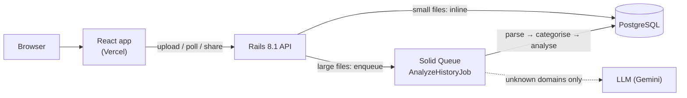

# BrowseWrapped API

[](https://github.com/MeghaKoshti/browsewrapped-api/actions/workflows/ci.yml)

**The Rails API behind BrowseWrapped.** It takes a browser-history export, classifies every URL into topics, and returns a "Wrapped"-style analytics report as JSON: persona, trends, heatmaps, sessions, streaks and a topic knowledge graph.

Frontend: [browsewrapped-web](https://github.com/MeghaKoshti/browsewrapped-web)


## How it works

```text
Upload (JSON / CSV)  or  local Chrome history (SQLite)
              │
              ▼
   HistoryParser        → normalises entries: url, title, visited_at, visit_count
              │
              ▼
   UrlCategorizer       → maps domains/URLs to topics (Programming, AI & ML, News…)
              │
              ▼
   HistoryAnalyzer      → builds the report: summary, persona, patterns, trends, graph
              │
              ▼
        JSON response   → rendered by browsewrapped-web
```

Small files are processed **in memory during the request**. Large files are analysed in the background by a Solid Queue job (see below): the raw upload is kept on disk only until the job has read it, and the finished report is deleted after 7 days.

## Architecture & decisions



**Key decisions**

- **Store aggregates, not history.** Uploads are parsed in memory; the raw file lives only until the job reads it, and reports are deleted after 7 days.
- **Async for big files, sync for small ones.** Solid Queue keeps 100 MB uploads from timing out, while demo-sized files skip the queue for a faster first impression.
- **JSONB for reports.** The report shape changes often; JSONB stores it without migrations and is still queryable.
- **Rules first, LLM second, cached per domain.** The LLM sees only domain names the rules couldn't place, in one batched call, and never the same domain twice.
- **Allowlist, not blocklist, for sharing.** New report sections stay private until they are explicitly added to `ReportSanitizer`.
- **Fail-safe AI.** No key, a timeout or a bad answer leaves a domain as "Other" instead of failing the analysis.

**What I'd do next**

- Stream-parse very large Takeout files instead of reading them into memory in the job.
- Move uploads to object storage (Active Storage + S3) so web and worker can run on separate machines.
- Add an admin view to review and correct AI categories (`source: "manual"`).

## API

### `POST /api/v1/analyses` (recommended)

Upload a history file as multipart form data (`file`, max 100 MB). Returns an analysis resource:

- Files under 5 MB are analysed straight away: **201** with `{ id, status: "completed", result }`.
- Bigger files are queued for `AnalyzeHistoryJob`: **202** with `{ id, status: "pending" }`.

### `GET /api/v1/analyses/:id`

Poll until `status` is `completed` (includes `result`) or `failed` (includes `error_message`). Statuses: `pending → processing → completed | failed`.

```bash
curl -F file=@sample/sample_history.json http://localhost:3000/api/v1/analyses
curl http://localhost:3000/api/v1/analyses/<id>
```

| Env var | Default | Purpose |
| --- | --- | --- |
| `ANALYSIS_SYNC_THRESHOLD_BYTES` | `5242880` (5 MB) | Uploads smaller than this are analysed inline |
| `ANALYSIS_UPLOAD_DIR` | `tmp/analysis_uploads` | Where uploads wait for the job (must be shared by web and worker) |
| `ANALYSIS_MAX_UPLOAD_BYTES` | `104857600` (100 MB) | Larger uploads get **413** |

In production the job runs on Solid Queue inside Puma (`SOLID_QUEUE_IN_PUMA=true`, already set in `config/deploy.yml`), or run `bin/jobs` as a separate worker on the same machine. `CleanupOldAnalysesJob` runs daily (`config/recurring.yml`) and removes analyses older than 7 days.

### AI categorisation for "Other" domains

After the rule-based `UrlCategorizer`, the background job sends the most-visited domains that are still "Other" to an LLM (Google Gemini, free tier) in **one batched call**, and maps them onto the existing categories only.

- **Cost-aware:** top 50 domains per report, and every answer is cached in `domain_categories`, so a domain is never sent twice. Rows with `source: "manual"` let you fix a category by hand.
- **Private:** only bare domain names are sent, never URLs, page titles or searches.
- **Fail-safe:** no API key, a timeout, an error or an invalid answer just leaves those domains as "Other". Responses are validated, and unknown categories become "Other".
- The report's `meta.ai_classified_domains` says how many domains the AI categorised.

| Env var | Default | Purpose |
| --- | --- | --- |
| `GEMINI_API_KEY` | none | Turns the feature on ([free key](https://aistudio.google.com/apikey)) |
| `GEMINI_MODEL` | `gemini-2.5-flash` | Model to use |
| `AI_CATEGORISATION` | `on` | Set to `off` to disable |
| `AI_CATEGORISATION_MAX_DOMAINS` | `50` | Domains per report sent to the LLM |

Tests use a stubbed classifier, so CI never calls the API.

### Shareable reports

| Method | Path | Notes |
| --- | --- | --- |
| `POST` | `/api/v1/shared_reports` | Body `{ analysis_id }` or `{ report }`. Returns **201** with `token`, `path` (`/r/:token`), `expires_at` and a one-time `delete_token` |
| `GET` | `/api/v1/shared_reports/:token` | The read-only report; **404** when unknown or expired |
| `DELETE` | `/api/v1/shared_reports/:token` | Needs the `X-Delete-Token` header; **204**, or **403** for a wrong token |

Privacy by design:

- `ReportSanitizer` keeps an **allowlist** of aggregated sections (persona, topics, charts, patterns). Page URLs and titles, search queries and domain names are never stored.
- Tokens come from `has_secure_token` (24 random characters), never the sequential id.
- The delete token is shown once; only its SHA-256 digest is saved.
- Links expire after 30 days and `CleanupExpiredSharedReportsJob` removes them daily.

### `POST /api/v1/analyze`

The original synchronous endpoint, kept for backward compatibility. Upload a history file as multipart form data (`file`, max 100 MB) and get the report back in the same request.

Supported formats:

- **Chrome Takeout:** `BrowserHistory.json` (`{ "Browser History": [...] }`)
- **JSON array:** `[{ "url", "title", "visitTime", "visitCount" }, ...]` (typical extension export)
- **CSV:** any file with a `url` column (title, time and count columns are detected automatically)

```bash
curl -F file=@sample/sample_history.json http://localhost:3000/api/v1/analyze
```

### `GET /api/v1/sample`

Returns the report for the bundled synthetic file (`sample/sample_history.json`), in the same shape as `/analyze` with `meta.source = "sample"`. The result is cached for a day, so repeat calls are instant. The web app's **Try with sample data** button uses this.

### Upload checks

Before anything is stored or parsed, `/analyses` and `/analyze` check the upload:

- no `file` → **422** `missing_file`; an empty file → **422** `empty_file`
- over the size limit → **413** `payload_too_large`
- not JSON or CSV → **415** `unsupported_media_type`. The first bytes are sniffed (JSON starts with `{` or `[`, CSV has a comma in its header line, binary bytes are rejected), so a PNG renamed to `history.json` is refused and a CSV saved as `.txt` still works.
- JSON/CSV the parser can't use → **422** `unsupported_format` (for `/analyses`, the analysis ends up `failed` with that message instead)

### Rate limits

Per IP, using Rails 8's `rate_limit` with counters in Solid Cache (shared by all workers). Over the limit you get **429** `rate_limited` with a `Retry-After: 60` header.

| Endpoint | Env var | Default |
| --- | --- | --- |
| `POST /api/v1/analyses` and `POST /api/v1/analyze` (one shared counter) | `UPLOAD_RATE_LIMIT_PER_MINUTE` | `10` per minute |
| `POST /api/v1/shared_reports` | `SHARE_RATE_LIMIT_PER_MINUTE` | `20` per minute |

Reading endpoints (polling, sample, shared report views) are not limited.

### Errors

Every error response has the same shape:

```json
{
  "error": { "code": "unsupported_media_type", "message": "Unsupported file type. Please upload a JSON or CSV history export." },
  "error_message": "Unsupported file type. Please upload a JSON or CSV history export."
}
```

Branch on `error.code`; `error.message` is safe to show users. `error_message` repeats the message as a plain string for older clients.

| Status | Codes |
| --- | --- |
| 400 | `bad_request` (malformed JSON body, missing parameter) |
| 403 | `invalid_delete_token` |
| 404 | `not_found` |
| 413 | `payload_too_large` |
| 415 | `unsupported_media_type` |
| 422 | `missing_file`, `empty_file`, `unsupported_format`, `no_entries`, `analysis_failed`, `nothing_to_share`, `invalid_report`, `chrome_read_failed` |
| 429 | `rate_limited` |

### `GET /api/v1/chrome`

Reads the local Chrome/Chromium history database directly (Linux and macOS), for when the API runs on your own machine.

### Response (top-level keys)

`summary`, `persona`, `topics`, `time_by_topic`, `daily_pattern`, `weekly_pattern`, `monthly_trends`, `heatmap`, `activity_calendar`, `sessions`, `streaks`, `topic_momentum`, `period_comparison`, `top_domains`, `top_pages`, `top_searches`, `chrome_searches`, `intent`, `knowledge_graph`, `meta`

#### `period_comparison`

Compares your most recent stretch of browsing with the one just before it: "Last 30 days" vs "Previous 30 days". The window is `min(30, span_days / 2)`, so a 20-day history compares 10 days with 10 days; histories shorter than 14 days (or with no timestamps) get `null`.

```json
{
  "window_days": 30,
  "current":  { "label": "Last 30 days", "from": "2026-09-01", "to": "2026-09-30", "visits": 820, "active_days": 25, "hours": 12.4, "top_topic": "Programming" },
  "previous": { "label": "Previous 30 days", "from": "2026-08-02", "to": "2026-08-31", "visits": 731, "active_days": 22, "hours": 13.0, "top_topic": "AI & ML" },
  "changes":  { "visits_pct": 12.2, "active_days_delta": 3, "hours_pct": -4.6 },
  "topics":   [{ "topic": "Programming", "current": 300, "previous": 250, "change_pct": 20.0 }]
}
```

- `hours` uses the same session-based estimate as `summary.total_hours_browsed`.
- Percentages are rounded to one decimal and are `null` when the previous value is 0.
- `topics` lists up to 8 topics (by visits across both windows), sorted by current visits. It holds topic names only, so the section is included in shared reports. Reports created before this section existed simply don't have the key.

## Tech stack

- Ruby on Rails 8.1 (API mode)
- PostgreSQL
- SQLite3 (to read Chrome's local history file)
- Solid Queue (background analysis of large files)
- Rack CORS (allows the Vite dev server on `localhost:5173`)
- Minitest, RuboCop and Brakeman, run on every push with GitHub Actions

## Getting started

### Prerequisites

- Ruby 3.4 (see `.ruby-version`; `mise install` works too)
- PostgreSQL running locally

### Setup

```bash
bundle install
bin/rails db:prepare
bin/rails server        # http://localhost:3000
```

Then start [browsewrapped-web](https://github.com/MeghaKoshti/browsewrapped-web) and upload `sample/sample_history.json`.

### Sample data

`sample/sample_history.json` is a **synthetic** file (about 1,250 visits over 60 days of developer-style browsing), so you can try the app without exporting your own history.

### Running tests

```bash
bin/rails test
```

The suite covers the parser (Takeout, JSON and CSV formats), the URL categorizer, the analyzer's report sections, the background analysis job and the API endpoints, including upload checks, rate limits and error responses. Rate-limit counters use an in-memory store in tests, cleared before each test.

## Project status

🚧 Actively in development. Next up: a live demo deployment.

## Author

**Megha Koshti**, Ruby on Rails developer · [GitHub](https://github.com/MeghaKoshti) · [LinkedIn](https://www.linkedin.com/in/megha-koshti)

## License

[MIT](LICENSE)
