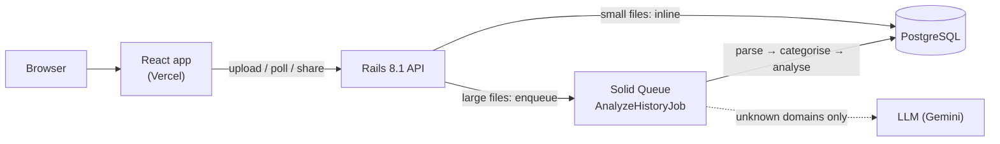

# BrowseWrapped API

[](https://github.com/MeghaKoshti/browsewrapped-api/actions/workflows/ci.yml)

**The Rails API behind BrowseWrapped.** It takes a browser-history export (JSON, CSV, or the history database straight from Firefox, Safari or Chrome), classifies every URL into topics, and returns a "Wrapped"-style analytics report as JSON: persona, trends, heatmaps, sessions, streaks and a topic knowledge graph.

Frontend: [browsewrapped-web](https://github.com/MeghaKoshti/browsewrapped-web)

**Live:** web app [browsewrapped.vercel.app](https://browsewrapped.vercel.app) · API [browsewrapped-api.onrender.com](https://browsewrapped-api.onrender.com) ([sample report](https://browsewrapped-api.onrender.com/api/v1/sample)). The API is on a free plan that sleeps after 15 minutes idle, so the first request can take up to a minute.

**Also in the API:**

- **Delete now:** every upload returns a one-time `delete_token`; `DELETE /api/v1/analyses/:id` removes the report straight away ([Privacy](#privacy)).
- **Rich link previews:** shares can carry the persona card PNG, and `/s/:token` serves Open Graph tags for WhatsApp, X and LinkedIn ([Shareable reports](#shareable-reports)).
- **Wrapped Pass:** a one-time Pass sold through Dodo Payments behind a provider interface, with verified, exactly-once webhooks and a fake provider for local work ([Billing](#billing-wrapped-pass)).
- **Passwordless sign-in:** single-use magic links restore a Pass on any device ([Pass sign-in](#pass-sign-in-magic-links)).
- **Owner admin and AI cost cap:** `/admin` behind HTTP Basic, and a hard daily ceiling on domains sent to the LLM ([Admin](#admin)).


## How it works

```text
Upload (JSON / CSV / Firefox, Safari or Chrome SQLite)  or  local Chrome history
              │
              ▼
   HistoryParser        → normalises entries: url, title, visited_at, visit_count
   SqliteHistoryReader    (history databases are read-only, from a temp copy)
              │
              ▼
   UrlCategorizer       → maps domains/URLs to topics (Programming, AI & ML, News…)
              │
              ▼
   HistoryAnalyzer      → builds the report: summary, persona, patterns, trends, graph
              │
              ▼
        JSON response   → rendered by browsewrapped-web
```

Small files are processed **in memory during the request**. Large files are analysed in the background by a Solid Queue job (see below): the raw upload is kept on disk only until the job has read it, and the finished report is deleted after 7 days (or straight away with its delete token, see [Privacy](#privacy)).

## Architecture & decisions



**Key decisions**

- **Store the report, not the history file.** Uploads are parsed in memory; the raw file lives only until the job reads it. The report is kept for 7 days and can be deleted at any time (see [Privacy](#privacy) for exactly what it contains).
- **Async for big files, sync for small ones.** Solid Queue keeps 100 MB uploads from timing out, while demo-sized files skip the queue for a faster first impression.
- **JSONB for reports.** The report shape changes often; JSONB stores it without migrations and is still queryable.
- **Rules first, LLM second, cached per domain.** The LLM sees only domain names the rules couldn't place, in one batched call, and never the same domain twice.
- **Allowlist, not blocklist, for sharing.** New report sections stay private until they are explicitly added to `ReportSanitizer`.
- **Fail-safe AI.** No key, a timeout or a bad answer leaves a domain as "Other" instead of failing the analysis.

**What I'd do next**

- Stream-parse very large Takeout files instead of reading them into memory in the job.
- Move uploads to object storage (Active Storage + S3) so web and worker can run on separate machines.

## API

### `POST /api/v1/analyses` (recommended)

Upload a history file as multipart form data (`file`, max 100 MB). Returns an analysis resource:

- Files under 5 MB are analysed straight away: **201** with `{ id, status: "completed", result }`.
- Bigger files are queued for `AnalyzeHistoryJob`: **202** with `{ id, status: "pending" }`.

The response also has a **`delete_token`**, returned only this once. Only its SHA-256 digest is stored.

### `DELETE /api/v1/analyses/:id`

Deletes the report (and the upload, if the job hasn't read it yet) right away. Send the token from the create response in the `X-Delete-Token` header: **204**, **403** `invalid_delete_token` for a wrong or missing token, **404** for an unknown id.

### `GET /api/v1/analyses/:id`

Poll until `status` is `completed` (includes `result`) or `failed` (includes `error_message`). Statuses: `pending → processing → completed | failed`.

```bash
curl -F file=@sample/sample_history.json http://localhost:3000/api/v1/analyses
curl http://localhost:3000/api/v1/analyses/<id>
```

| Env var | Default | Purpose |
| --- | --- | --- |
| `ANALYSIS_SYNC_THRESHOLD_BYTES` | `5242880` (5 MB) | Uploads smaller than this are analysed inline |
| `ANALYSIS_UPLOAD_DIR` | `tmp/analysis_uploads` | Where uploads wait for the job (must be shared by web and worker) |
| `ANALYSIS_MAX_UPLOAD_BYTES` | `104857600` (100 MB) | Larger uploads get **413** |

In production the job runs on Solid Queue inside Puma (`SOLID_QUEUE_IN_PUMA=true`, set in `fly.toml`), or run `bin/jobs` as a separate worker on the same machine. `CleanupOldAnalysesJob` runs daily (`config/recurring.yml`) and removes analyses older than 7 days.

### AI categorisation for "Other" domains

After the rule-based `UrlCategorizer`, the job sends the most-visited domains that are still "Other" to an LLM (Google Gemini) in **one batched call**, and maps them onto the existing categories only.

- **Cost-aware:** top 50 domains per report, and every answer is cached in `domain_categories`, so a domain is never sent twice. Rows with `source: "manual"` let you fix a category by hand.
- **Private:** only bare public domain names are sent, never URLs, page titles or searches. IP addresses, `localhost`, single-label intranet names (`wiki`, `jira`) and `*.local`, `*.internal`, `*.corp`, `*.lan`, `*.home`, `*.intranet` hosts are never sent.
- **Cheap and quick:** Flash-Lite by default, with thinking switched off (`thinkingBudget: 0`). On the inline path (small uploads, where a person is waiting) the LLM call gets a 5-second budget in total; the background job allows 25 seconds.
- **Fail-safe:** no API key, a timeout, an error or an invalid answer just leaves those domains as "Other". Responses are validated, and unknown categories become "Other".
- The report's `meta.ai_classified_domains` says how many domains the AI categorised.

| Env var | Default | Purpose |
| --- | --- | --- |
| `GEMINI_API_KEY` | none | Turns the feature on ([free key](https://aistudio.google.com/apikey)) |
| `GEMINI_MODEL` | `gemini-2.5-flash-lite` | Model to use |
| `AI_CATEGORISATION` | `on` | Set to `off` to disable |
| `AI_CATEGORISATION_MAX_DOMAINS` | `50` | Domains per report sent to the LLM |
| `AI_DAILY_DOMAIN_BUDGET` | `2000` | Hard daily ceiling (UTC day) on domains sent to the LLM. Once used up, reports use only cached answers until midnight UTC, and the log says so once |

Tests use a stubbed classifier, so CI never calls the API.

### Shareable reports

| Method | Path | Notes |
| --- | --- | --- |
| `POST` | `/api/v1/shared_reports` | Body `{ analysis_id }` or `{ report }`, as JSON, or as multipart form data with an optional `card` image (then `report` is a JSON string). Returns **201** with `token`, `path` (`/r/:token`), `preview_url`, `expires_at` and a one-time `delete_token` |
| `GET` | `/api/v1/shared_reports/:token` | The read-only report; **404** when unknown or expired |
| `GET` | `/api/v1/shared_reports/:token/card.png` | The persona card; **404** without one |
| `GET` | `/s/:token` | Link-preview page (see below) |
| `DELETE` | `/api/v1/shared_reports/:token` | Needs the `X-Delete-Token` header; **204**, or **403** for a wrong token |

Privacy by design:

- `ReportSanitizer` keeps an **allowlist** of aggregated sections (persona, topics, charts, patterns). Page URLs and titles, search queries and domain names are never stored.
- Tokens come from `has_secure_token` (24 random characters), never the sequential id.
- The delete token is shown once; only its SHA-256 digest is saved.
- Links expire after 30 days and `CleanupExpiredSharedReportsJob` removes them daily.

**Link previews.** WhatsApp, X, LinkedIn and Slack don't run JavaScript, so the web app's `/r/:token` looks blank to them. The link people copy is `preview_url` (`${API_PUBLIC_URL}/s/:token`): a tiny server-rendered page with `og:title` (the persona), `og:description`, `og:image` (the card, or `OG_FALLBACK_IMAGE_URL`, default `${WEB_URL}/og-image.png`) and `twitter:card=summary_large_image`, which sends visitors straight on to `${WEB_URL}/r/:token`. Unknown or expired tokens get a **404** with generic tags and no redirect.

The card is checked before anything is saved: PNG magic bytes and IHDR (the content type is ignored, **415** `unsupported_media_type` otherwise), at most 300 KB (**413** `payload_too_large`) and exactly 1200×630 (**422** `invalid_card_dimensions`). It is stored in Postgres (`share_cards`, `bytea`), so it survives machine restarts without a volume, and is deleted with its share (foreign key `ON DELETE CASCADE`, which also covers the daily cleanup).

### `POST /api/v1/analyze`

The original synchronous endpoint, kept for backward compatibility. Upload a history file as multipart form data (`file`, max 100 MB) and get the report back in the same request.

```bash
curl -F file=@sample/sample_history.json http://localhost:3000/api/v1/analyze
```

### Supported formats

Both upload endpoints accept the same files. The format is recognised from the content, never the file name, so a renamed file still works.

| Format | File | Recognised by | Timestamps |
| --- | --- | --- | --- |
| Chrome Takeout | `BrowserHistory.json` | `{ "Browser History": [...] }` | `time_usec` |
| JSON array (extension exports) | any `.json` | `[{ "url", "title", "visitTime", "visitCount" }, ...]` | ms, s or ISO 8601 |
| CSV | any `.csv` / `.txt` | a `url` column (title, time and count columns are detected) | times without a UTC offset are read as UTC |
| Firefox | `places.sqlite` | tables `moz_places` + `moz_historyvisits` | µs since 1970-01-01 UTC |
| Safari | `History.db` | tables `history_items` + `history_visits` | seconds since 2001-01-01 UTC |
| Chrome, Edge, Brave and other Chromium browsers | `History` (no extension) | tables `urls` + `visits` | µs since 1601-01-01 UTC |

Each visit in a database becomes one entry, newest first, capped at 200,000 visits. Other SQLite files get **415** `unsupported_sqlite`, and a damaged one gets **422** `corrupt_sqlite`.

#### Where to find the history database

| Browser | Windows | macOS | Linux |
| --- | --- | --- | --- |
| Firefox | `%APPDATA%\Mozilla\Firefox\Profiles\<profile>\places.sqlite` | `~/Library/Application Support/Firefox/Profiles/<profile>/places.sqlite` | `~/.mozilla/firefox/<profile>/places.sqlite` (Snap: `~/snap/firefox/common/.mozilla/firefox/`) |
| Safari | – | `~/Library/Safari/History.db` | – |
| Chrome | `%LOCALAPPDATA%\Google\Chrome\User Data\Default\History` | `~/Library/Application Support/Google/Chrome/Default/History` | `~/.config/google-chrome/Default/History` |
| Edge | `%LOCALAPPDATA%\Microsoft\Edge\User Data\Default\History` | `~/Library/Application Support/Microsoft Edge/Default/History` | `~/.config/microsoft-edge/Default/History` |

Tips: `about:support` → *Profile Folder* (Firefox) and `chrome://version` → *Profile Path* (Chrome, Edge) show the exact folder. Other profiles live next to `Default` (`Profile 1`, …).

**Copy the file before uploading, ideally with the browser closed.** Firefox and Chrome lock their database while they run and keep the newest visits in a separate `-wal` file, so uploading the live file can fail or miss recent history. On macOS, reading `~/Library/Safari` from Terminal needs *Full Disk Access*; copying it in Finder (*Go → Go to Folder…*) also works.

How databases are read safely: the upload is copied to a private temp folder and opened **read-only and immutable** (no locks, no journal or WAL files), extensions are never loaded, functions in the file's schema are not trusted, only real tables (not views) are queried, each query has a 10-second limit, and the temp copy is deleted afterwards. The normal upload size limit applies.

### `GET /api/v1/sample`

Returns the report for the bundled synthetic file (`sample/sample_history.json`), in the same shape as `/analyze` with `meta.source = "sample"`. The result is cached for a day, so repeat calls are instant. The web app's **Try with sample data** button uses this.

### Upload checks

Before anything is stored or parsed, `/analyses` and `/analyze` check the upload:

- no `file` → **422** `missing_file`; an empty file → **422** `empty_file`
- over the size limit → **413** `payload_too_large`
- not JSON, CSV or SQLite → **415** `unsupported_media_type`. The first bytes are sniffed (JSON starts with `{` or `[`, CSV has a comma in its header line, SQLite starts with `SQLite format 3\0`, other binary bytes are rejected), so a PNG renamed to `history.json` is refused and a CSV saved as `.txt` still works.
- a SQLite database that isn't Firefox, Safari or Chrome history → **415** `unsupported_sqlite`; a damaged one → **422** `corrupt_sqlite`
- JSON/CSV the parser can't use → **422** `unsupported_format` (for `/analyses`, the analysis ends up `failed` with that message instead)

### Rate limits

Per IP, using Rails 8's `rate_limit` with counters in Solid Cache (shared by all workers). Over the limit you get **429** `rate_limited` with a `Retry-After: 60` header.

| Endpoint | Env var | Default |
| --- | --- | --- |
| `POST /api/v1/analyses` and `POST /api/v1/analyze` (one shared counter) | `UPLOAD_RATE_LIMIT_PER_MINUTE` | `10` per minute |
| `POST /api/v1/shared_reports` | `SHARE_RATE_LIMIT_PER_MINUTE` | `20` per minute |
| `POST /api/v1/checkouts` | `CHECKOUT_RATE_LIMIT_PER_MINUTE` | `10` per minute |
| `POST /api/v1/sessions/magic_link` | `MAGIC_LINK_RATE_LIMIT_PER_MINUTE` | `5` per minute (plus 5 per hour per email address, silently) |
| `POST /api/v1/sessions/verify` | – | `20` per minute |

Reading endpoints (polling, sample, shared report views) are not limited.

### Errors

Every error response has the same shape:

```json
{
  "error": { "code": "unsupported_media_type", "message": "Unsupported file type. Please upload a JSON or CSV export, or a Firefox, Safari or Chrome history database." },
  "error_message": "Unsupported file type. Please upload a JSON or CSV export, or a Firefox, Safari or Chrome history database."
}
```

Branch on `error.code`; `error.message` is safe to show users. `error_message` repeats the message as a plain string for older clients.

| Status | Codes |
| --- | --- |
| 400 | `bad_request` (malformed JSON body, missing parameter), `invalid_payload` |
| 401 | `invalid_signature`, `invalid_or_expired_token`, `unauthorized` |
| 402 | `pass_required` |
| 403 | `invalid_delete_token` |
| 404 | `not_found`, `disabled` (local Chrome import switched off) |
| 413 | `payload_too_large` |
| 415 | `unsupported_media_type`, `unsupported_sqlite` |
| 422 | `invalid_card_dimensions`, `missing_file`, `empty_file`, `unsupported_format`, `corrupt_sqlite`, `no_entries`, `analysis_failed`, `nothing_to_share`, `invalid_report`, `chrome_read_failed`, `invalid_email`, `invalid_currency`, `invalid_plan` |
| 429 | `rate_limited` |
| 503 | `checkout_unavailable` |

### `GET /api/v1/chrome`

Reads the local Chrome/Chromium history database directly (Linux and macOS), for when the API runs on your own machine. It reads the history of **the machine the API runs on**, so it is off unless `LOCAL_CHROME_IMPORT=on` (the default only in development) and returns **404** `disabled` otherwise.

### Response (top-level keys)

`summary`, `persona`, `topics`, `time_by_topic`, `daily_pattern`, `weekly_pattern`, `monthly_trends`, `heatmap`, `activity_calendar`, `sessions`, `streaks`, `topic_momentum`, `period_comparison`, `top_domains`, `top_pages`, `top_searches`, `chrome_searches`, `intent`, `knowledge_graph`, `meta`

#### `period_comparison`

Compares your most recent stretch of browsing with the one just before it: "Last 30 days" vs "Previous 30 days". The window is `min(30, span_days / 2)`, so a 20-day history compares 10 days with 10 days; histories shorter than 14 days (or with no timestamps) get `null`.

```json
{
  "window_days": 30,
  "current":  { "label": "Last 30 days", "from": "2026-09-01", "to": "2026-09-30", "visits": 820, "active_days": 25, "hours": 12.4, "top_topic": "Programming" },
  "previous": { "label": "Previous 30 days", "from": "2026-08-02", "to": "2026-08-31", "visits": 731, "active_days": 22, "hours": 13.0, "top_topic": "AI & ML" },
  "changes":  { "visits_pct": 12.2, "active_days_delta": 3, "hours_pct": -4.6 },
  "topics":   [{ "topic": "Programming", "current": 300, "previous": 250, "change_pct": 20.0 }]
}
```

- `hours` uses the same session-based estimate as `summary.total_hours_browsed`.
- Percentages are rounded to one decimal and are `null` when the previous value is 0.
- `topics` lists up to 8 topics (by visits across both windows), sorted by current visits. It holds topic names only, so the section is included in shared reports. Reports created before this section existed simply don't have the key.

## Privacy

What the server keeps, and for how long:

| Data | Where | Kept for |
| --- | --- | --- |
| The uploaded file | Request memory (small files) or `ANALYSIS_UPLOAD_DIR` (large files) | Until it is parsed: seconds. Never logged |
| The report (`analyses.result`) | PostgreSQL | **7 days**, or until you call `DELETE /api/v1/analyses/:id` with the delete token. It includes your top 15 pages (URLs and titles), up to 30 search queries, your Chrome searches and top domains, plus the aggregated charts. Anyone with the analysis id can read it, so the id is never shown in share links |
| A shared report | PostgreSQL | 30 days, or until deleted with its delete token. Aggregates only (see `ReportSanitizer`) |
| Domain names the rules couldn't place | Sent to Gemini; the answer is cached in `domain_categories` | The cache is kept; it holds domain names and categories, nothing tied to a person |
| A share's persona card (PNG, ≤ 300 KB) | PostgreSQL (`share_cards`) | Deleted with its share |
| A Pass purchase: email, plan, amount, currency, the provider's payment id, valid-until date | PostgreSQL (`purchases`) | Kept; there is no automatic deletion yet (decide a retention period before launch) |
| Billing webhook ids | PostgreSQL (`billing_events`) | Event id, type and payment id only, never the payload. Kept, to ignore repeats |
| Sign-in links | PostgreSQL (`magic_link_tokens`): email and SHA-256 digest of the token | 15 minutes, then deleted by a daily job |

- Request logs filter `report`, `email`, tokens and secrets (`config/initializers/filter_parameter_logging.rb`); a test checks that a posted report shows up as `[FILTERED]`.
- Delete tokens and share tokens are random; only SHA-256 digests of delete tokens are stored.

## Billing (Wrapped Pass)

A one-time **Wrapped Pass** (12 months) sold through a merchant of record. Everything sits behind `Billing::Provider`, so switching providers is one adapter:

| Adapter | When | What it does |
| --- | --- | --- |
| `Billing::FakeProvider` | development and test (default there) | Checkout URL is a tiny page on this API with **Pay (fake)** and **Cancel**. Paying sends a correctly signed, Dodo-shaped `payment.succeeded` webhook through the real webhook endpoint (in-process), then redirects to `${WEB_URL}/billing/success?email=…`. Returns 404 in production |
| `Billing::DodoProvider` | production (default there) | [Dodo Payments](https://docs.dodopayments.com/developer-resources/checkout-session) hosted checkout. HTTP goes through an injected transport, so tests never call Dodo |

| Method | Path | Notes |
| --- | --- | --- |
| `GET` | `/api/v1/pricing` | `{ plan, prices: { INR: { amount, early_bird_amount }, USD: {…} }, early_bird_until, valid_days }`. Amounts in paise/cents. The early-bird price applies while now < `early_bird_until` |
| `POST` | `/api/v1/checkouts` | `{ email, currency: "INR" \| "USD" }` → **201** `{ checkout_url }`. **422** `invalid_email`, `invalid_currency`, `invalid_plan`; **503** `checkout_unavailable` if the provider fails or is misconfigured. The price always comes from config, never from the client. Rate limited per IP |
| `POST` | `/api/v1/webhooks/billing` | Provider webhooks. **401** `invalid_signature`, **400** `invalid_payload`, otherwise **200** |

How webhooks are handled:

- **Verified:** [Standard Webhooks](https://www.standardwebhooks.com/) HMAC-SHA256 over `webhook-id.webhook-timestamp.raw body` with the base64 secret (`whsec_…`). Timestamps more than 5 minutes off are rejected.
- **Exactly once:** each `webhook-id` is stored in `billing_events` (unique index) in the same transaction as its effect. Retries return 200 and change nothing; a failure rolls back so the retry is processed.
- `payment.succeeded` for the Pass creates a `Purchase` valid for 365 days. Buying again while a Pass is active extends it.
- `refund.succeeded` revokes the purchase (a partial refund keeps it). Other events are acknowledged and ignored.
- No webhook payload is stored, only the event id, type and payment id.

Try it locally (the fake provider is the default outside production):

```bash
curl -X POST localhost:3000/api/v1/checkouts -H 'Content-Type: application/json' \
  -d '{"email":"me@example.com","currency":"INR"}'
# open the checkout_url, click "Pay (fake)"
```

Going live with Dodo: create the "Wrapped Pass" product in USD and INR, a discount code for the early-bird price, and a webhook endpoint pointing at `https://<api>/api/v1/webhooks/billing` with the `payment.succeeded` and `refund.succeeded` events.

Billing settings (full list in the [env table](#deploy-flyio)):

| Env var | Default | Purpose |
| --- | --- | --- |
| `BILLING_PROVIDER` | `dodo` in production, `fake` elsewhere | Which adapter to use. `fake` is refused in production |
| `DODO_API_KEY`, `DODO_ENVIRONMENT` | none, `test_mode` | Dodo API key and mode (`test_mode` or `live_mode`) |
| `DODO_WEBHOOK_SECRET` | none | The webhook endpoint's `whsec_…` secret |
| `DODO_PRODUCT_PASS_USD`, `DODO_PRODUCT_PASS_INR` | none | Product ids of the Pass in each currency |
| `EARLY_BIRD_UNTIL` | `2026-12-15T23:59:59Z` | End of the early-bird price; `off` turns it off |
| `DODO_EARLY_BIRD_DISCOUNT_CODE` | none | Discount code that brings the Dodo price down to the early-bird amount. Needed while the early bird runs: checkout refuses to start without it rather than overcharge |
| `WEB_URL` | `http://localhost:5173` | Where checkout returns (`/billing/success`, `/billing/cancel`) and sign-in links point |
| `API_PUBLIC_URL` | `http://localhost:3000` | This API's public address (fake checkout URL, share `preview_url`) |

To check the whole flow locally, run the API and [browsewrapped-web](https://github.com/MeghaKoshti/browsewrapped-web#3-try-the-pass-locally) and buy a Pass on `http://localhost:5173/pricing` with the fake provider. To replay a webhook by hand, send the same body and `webhook-*` headers twice: the second answer is `{"received":true,"duplicate":true}` and the Pass is not extended again.

### Pass sign-in (magic links)

No passwords: a Pass belongs to an email address, and any device can unlock it with a single-use emailed link.

| Method | Path | Notes |
| --- | --- | --- |
| `POST` | `/api/v1/sessions/magic_link` | `{ email }` → **202, always**, whatever the address (no account enumeration). Emails `${WEB_URL}/auth/verify?token=…`, valid **15 minutes, once** |
| `POST` | `/api/v1/sessions/verify` | `{ token }` → **200** `{ access_token, email, pass_valid_until }`; **401** `invalid_or_expired_token`. POST so tokens stay out of access logs |
| `GET` | `/api/v1/me` | `Authorization: Bearer <access_token>` → `{ email, pass_valid_until, has_pass }`; **401** `unauthorized` |

- Only the SHA-256 digest of a link token is stored, and redeeming it is one conditional `UPDATE`, so a link can't be used twice even by two requests at once. Expired tokens are deleted daily.
- The access token is signed with `Rails.application.message_verifier(:pass_session)` and expires after 30 days. It holds only the email; the Pass is looked up on every request, so a refund takes effect immediately.
- A link is sent to any valid address, Pass or not. The success page asks for one straight after paying, maybe before the payment webhook has arrived, and then polls `/me` until `has_pass` is true.
- Rate limits: 5 requests per minute per IP (then **429**), and 5 emails per hour per address (further requests still get the same 202, but nothing is sent).
- With the fake provider, the checkout's success redirect also carries `&token=…`, so the whole flow can be clicked through locally without email.
- Pass-only endpoints use the `Entitlements` concern: `before_action :require_pass!` answers **402** `pass_required`.
- The email is sent inline, not through a job, so the plain token never sits in job arguments (logs or Solid Queue tables). If sending fails, the answer is still 202 and the error is logged.
- Preview the email at `http://localhost:3000/rails/mailers/pass_mailer/magic_link`. In development emails are written to `tmp/mails/<address>` instead of sent; in production they go over SMTP: set `SMTP_ADDRESS`, `SMTP_PORT` (default 587, STARTTLS), `SMTP_USERNAME`, `SMTP_PASSWORD` and `MAIL_FROM` (a sender on a domain with SPF and DKIM).

## Admin

A small owner-only page at `/admin`, behind HTTP Basic auth from `ADMIN_USER` and `ADMIN_PASSWORD`. If either is unset, `/admin` returns **404**; wrong or missing credentials get **401**.

- **Today (UTC):** analyses by status, shares created, Pass sales by currency, and LLM domains used against `AI_DAILY_DOMAIN_BUDGET`.
- **Failures** in the last 7 days, grouped by `error_message`.
- **Fix a category:** saves a `DomainCategory` with `source: "manual"`. Manual rows always win, because the AI never overwrites an existing row. The 30 most recently categorised domains are listed to review.

Browsers resend Basic credentials on cross-site form posts, and the API has no session for Rails' CSRF tokens. So each admin form carries a token derived from the credentials (an HMAC with `SECRET_KEY_BASE`), and posts without it are refused.

## Tech stack

- Ruby on Rails 8.1 (API mode)
- PostgreSQL
- SQLite3 (to read uploaded Firefox, Safari and Chrome history databases, and the local Chrome history)
- Solid Queue (background analysis of large files)
- Rack CORS (origins from `CORS_ORIGINS`, plus the Vite dev server on `localhost:5173` in development)
- Fly.io (Docker image with Thruster in front of Puma)
- Minitest, RuboCop and Brakeman, run on every push with GitHub Actions

## Getting started

### Prerequisites

- Ruby 3.4 (see `.ruby-version`; `mise install` works too)
- PostgreSQL running locally

### Setup

```bash
bundle install
bin/rails db:prepare
bin/rails server        # http://localhost:3000
```

Then start [browsewrapped-web](https://github.com/MeghaKoshti/browsewrapped-web) and upload `sample/sample_history.json`.

### Sample data

`sample/sample_history.json` is a **synthetic** file (about 1,250 visits over 60 days of developer-style browsing), so you can try the app without exporting your own history.

### Running tests

```bash
bin/rails test
```

The suite covers the parser (Takeout, JSON and CSV formats, plus tiny Firefox, Safari and Chrome databases built in `test/support/history_databases.rb`), the URL categorizer, the analyzer's report sections, the background analysis job and the API endpoints, including upload checks, rate limits and error responses. Rate-limit counters use an in-memory store in tests, cleared before each test.

## Deploy (Render + Neon, free)

This is the live setup, and it costs nothing:

| Part | Service | Notes |
|---|---|---|
| API (this repo) | [Render](https://render.com) free web service, Docker, Singapore | https://browsewrapped-api.onrender.com. Sleeps after 15 minutes without traffic; the next request waits for it to start (up to about a minute). The web app retries during that time |
| Database | [Neon](https://neon.com) free Postgres, Singapore | 1 GB storage, compute pauses when idle. Use the **direct** connection string, not the pooled one |
| Web app | Vercel Hobby | https://browsewrapped.vercel.app |

`render.yaml` describes the service (a Render Blueprint), so the settings live in the repo.

1. **Neon:** create a project in Singapore, copy the direct connection string, and in the SQL editor create the three extra databases Rails uses:
   ```sql
   CREATE DATABASE neondb_cache;
   CREATE DATABASE neondb_queue;
   CREATE DATABASE neondb_cable;
   ```
   (Their names come from the primary database name in `DATABASE_URL` plus `_cache`, `_queue` and `_cable`.)
2. **Render:** New → Blueprint → this repo (or New → Web Service → Docker, region Singapore, plan Free, health check `/up`) and set:

   | Variable | Value |
   |---|---|
   | `DATABASE_URL` | Neon's direct connection string (secret) |
   | `SECRET_KEY_BASE` | generated by the Blueprint, or `openssl rand -hex 64` |
   | `HTTP_PORT` | `10000` (Render's port; Thruster listens here) |
   | `SOLID_QUEUE_IN_PUMA` | `true` (no separate worker on the free plan) |
   | `ANALYSIS_MAX_UPLOAD_BYTES` | `26214400` (25 MB, because the free instance has 512 MB RAM and uploads are parsed in memory) |
   | `CORS_ORIGINS` | `https://browsewrapped.vercel.app` |
   | `WEB_URL` | `https://browsewrapped.vercel.app` |
   | `API_PUBLIC_URL` | `https://browsewrapped-api.onrender.com` |
   | `GEMINI_API_KEY` | optional; without it unknown sites stay "Other" |

   The container runs `bin/rails db:prepare` on start (`bin/docker-entrypoint`), which creates and migrates all four databases.
3. **Check:** `curl https://browsewrapped-api.onrender.com/up`, then `/api/v1/sample`. `GET /` answers with a small JSON landing.

**Free-tier trade-offs:** cold starts after 15 idle minutes; background jobs only run while the service is awake, and the daily cleanup (old analyses, expired share links) only runs if the service happens to be awake at its scheduled time, so expired reports can stay in the database longer than 7 days until a run catches them; Neon's free compute is limited per month, so don't add a keep-alive pinger. Billing stays off until the Dodo variables below are set: `POST /api/v1/checkouts` answers 503 `checkout_unavailable`.

## Deploy (Fly.io, paid alternative)

Fly.io is the paid alternative (no free tier; a Postgres cluster is extra); `fly.toml` is in the repo. One machine in Mumbai (`bom`) runs Thruster → Puma, with Solid Queue inside Puma, next to a Fly Postgres cluster.

```bash
# 1. Create the app from the existing fly.toml (keep the existing Dockerfile if asked)
fly launch --copy-config --no-deploy --name browsewrapped-api-<you>

# 2. Postgres: create a cluster and attach it (this sets the DATABASE_URL secret)
fly postgres create --name browsewrapped-db --region bom
fly postgres attach browsewrapped-db --app browsewrapped-api-<you>

# 3. Secrets
fly secrets set SECRET_KEY_BASE=$(bin/rails secret) \
  CORS_ORIGINS=https://<your-web-app>.vercel.app \
  GEMINI_API_KEY=<optional>

# Public addresses (checkout returns, sign-in links, share previews)
fly secrets set WEB_URL=https://<your-web-app>.vercel.app \
  API_PUBLIC_URL=https://browsewrapped-api-<you>.fly.dev

# Wrapped Pass payments (Dodo test mode first; switch DODO_ENVIRONMENT=live_mode when ready)
fly secrets set DODO_API_KEY=<key> DODO_ENVIRONMENT=test_mode \
  DODO_WEBHOOK_SECRET=whsec_<...> \
  DODO_PRODUCT_PASS_USD=<product id> DODO_PRODUCT_PASS_INR=<product id> \
  EARLY_BIRD_UNTIL=2026-12-15T23:59:59Z DODO_EARLY_BIRD_DISCOUNT_CODE=<code>

# Sign-in emails (any transactional provider's SMTP)
fly secrets set SMTP_ADDRESS=<host> SMTP_PORT=587 SMTP_USERNAME=<user> SMTP_PASSWORD=<password> \
  MAIL_FROM="BrowseWrapped <hello@yourdomain>"

# Owner admin and LLM spend cap
fly secrets set ADMIN_USER=<you> ADMIN_PASSWORD=$(openssl rand -hex 24) AI_DAILY_DOMAIN_BUDGET=2000

# Optional: tune the rate limits
fly secrets set UPLOAD_RATE_LIMIT_PER_MINUTE=10 SHARE_RATE_LIMIT_PER_MINUTE=20

# 4. Deploy, then check
fly deploy
curl https://browsewrapped-api-<you>.fly.dev/up
curl https://browsewrapped-api-<you>.fly.dev/api/v1/sample
```

Then point browsewrapped-web at `https://browsewrapped-api-<you>.fly.dev`. `fly logs` tails the logs and `fly ssh console -C "bin/rails console"` opens a console.

After deploying, point the Dodo webhook at `https://browsewrapped-api-<you>.fly.dev/api/v1/webhooks/billing` and buy a Pass in test mode from the live site before switching to `live_mode`.

> **Web hosting and selling:** the web app's Vercel **Hobby** plan is **non-commercial only**. Before you sell the Pass, upgrade the Vercel project to Pro, or serve the web build from Fly (see the [web README's deploy section](https://github.com/MeghaKoshti/browsewrapped-web#deploy)).

What `fly.toml` sets up:

- **Release step:** `release_command = "./bin/rails db:prepare"` runs before each new version starts. The first time it creates the primary database plus `<db>_cache`, `<db>_queue` and `<db>_cable` on the same Postgres server (`fly postgres attach` gives the app's user the rights to do that). To use other databases, set `CACHE_DATABASE_URL`, `QUEUE_DATABASE_URL` or `CABLE_DATABASE_URL`.
- **Port:** Thruster listens on `8080` (`HTTP_PORT`) and proxies to Puma on 3000. The Dockerfile's default of 80 needs root, and the container runs as a normal user.
- **Health check:** `GET /up` every 30 seconds. HTTPS is enforced by Fly and the app (`assume_ssl`, `force_ssl`, with `/up` excluded).
- **Jobs and uploads on one machine:** `SOLID_QUEUE_IN_PUMA=true` runs the background analysis in the same machine that received the upload, so the raw file can wait in a local folder (`ANALYSIS_UPLOAD_DIR=/rails/tmp/analysis_uploads`) for the few seconds until the job reads and deletes it. No volume or object storage is needed. If you ever split web and worker onto separate machines, move uploads to object storage first (see "What I'd do next").
- **Always one machine:** `min_machines_running = 1`, because that machine is also the job worker and runs the daily cleanup (analyses after 7 days, expired share links). Setting it to 0 is cheaper for a demo, but the first request after a pause is slow and the cleanup only runs if the machine happens to be awake at 3am.
- **Memory:** 1 GB, because uploads of up to 100 MB are parsed in memory.

| Variable | Set by | Required | Purpose |
| --- | --- | --- | --- |
| `DATABASE_URL` | `fly postgres attach` | yes | Primary database; the cache, queue and cable databases are derived from it |
| `SECRET_KEY_BASE` | `fly secrets set` | yes | Rails secret. The app doesn't use encrypted credentials, so this is all it needs. If you add credentials later, set `RAILS_MASTER_KEY` instead |
| `CORS_ORIGINS` | `fly secrets set` | yes, for the web app | Comma-separated origins allowed to call the API, e.g. `https://browsewrapped.vercel.app`. Empty means no browser origin is allowed |
| `GEMINI_API_KEY` | `fly secrets set` | no | Turns on AI categorisation |
| `GEMINI_MODEL` | `fly secrets set` | no | Defaults to `gemini-2.5-flash-lite` |
| `LOCAL_CHROME_IMPORT` | – | no | Leave unset in production: `GET /api/v1/chrome` stays off (404) |
| `AI_DAILY_DOMAIN_BUDGET` | `fly secrets set` | no | Daily ceiling on domains sent to the LLM (default 2000) |
| `ADMIN_USER`, `ADMIN_PASSWORD` | `fly secrets set` | no | Turn on `/admin` (HTTP Basic). Use a long random password |
| `WEB_URL` | `fly secrets set` | yes, for billing | Where the web app lives, e.g. `https://browsewrapped.app`; used for checkout return links. Default `http://localhost:5173` |
| `API_PUBLIC_URL` | `fly secrets set` | yes, for billing and share previews | This API's public URL, e.g. `https://browsewrapped-api.fly.dev`; used in `preview_url` and the fake checkout. Default `http://localhost:3000` |
| `OG_FALLBACK_IMAGE_URL` | `fly secrets set` | no | Preview image for shares without a card (default `${WEB_URL}/og-image.png`) |
| `BILLING_PROVIDER` | `fly secrets set` | no | `dodo` (default in production) or `fake` (default elsewhere; refused in production) |
| `DODO_API_KEY` | `fly secrets set` | yes, for Dodo | API key for the mode below |
| `DODO_ENVIRONMENT` | `fly secrets set` | no | `test_mode` (default) or `live_mode` |
| `DODO_WEBHOOK_SECRET` | `fly secrets set` | yes, for Dodo | The endpoint's `whsec_…` signing secret |
| `DODO_PRODUCT_PASS_USD`, `DODO_PRODUCT_PASS_INR` | `fly secrets set` | yes, for Dodo | Product ids of the Pass in each currency |
| `DODO_EARLY_BIRD_DISCOUNT_CODE` | `fly secrets set` | while the early bird runs | Dodo discount code that brings the price down to the early-bird amount. Checkout refuses to start without it rather than overcharge |
| `EARLY_BIRD_UNTIL` | `fly secrets set` | no | ISO 8601 end of the early-bird price (default `2026-12-15T23:59:59Z`); `off` disables it |
| `CHECKOUT_RATE_LIMIT_PER_MINUTE` | `fly secrets set` | no | Per-IP limit for `POST /api/v1/checkouts` (default 10) |
| `SMTP_ADDRESS`, `SMTP_PORT`, `SMTP_USERNAME`, `SMTP_PASSWORD` | `fly secrets set` | yes, for sign-in emails | Any transactional email provider's SMTP settings (port defaults to 587, STARTTLS) |
| `MAIL_FROM` | `fly secrets set` | yes, for sign-in emails | e.g. `BrowseWrapped <hello@yourdomain>`; the domain needs SPF and DKIM |
| `MAGIC_LINK_RATE_LIMIT_PER_MINUTE`, `MAGIC_LINK_EMAIL_LIMIT_PER_HOUR` | `fly secrets set` | no | Magic-link limits per IP (default 5/min) and per address (default 5/hour) |
| `UPLOAD_RATE_LIMIT_PER_MINUTE`, `SHARE_RATE_LIMIT_PER_MINUTE` | `fly secrets set` | no | Per-IP rate limits (defaults 10 and 20) |
| `ANALYSIS_SYNC_THRESHOLD_BYTES`, `ANALYSIS_MAX_UPLOAD_BYTES` | `fly secrets set` | no | Inline vs background threshold (5 MB) and upload limit (100 MB) |
| `CACHE_DATABASE_URL`, `QUEUE_DATABASE_URL`, `CABLE_DATABASE_URL` | `fly secrets set` | no | Override the derived database URLs |
| `SOLID_QUEUE_IN_PUMA`, `HTTP_PORT`, `ANALYSIS_UPLOAD_DIR`, `RAILS_LOG_LEVEL` | `fly.toml` | – | See above |

**Kamal:** `config/deploy.yml` (the Rails default Kamal config) is still in the repo for deploying to your own server, but Render is the live path.

To try the production setup locally:

```bash
RAILS_ENV=production DATABASE_URL=postgres://localhost/browsewrapped_production \
  SECRET_KEY_BASE=dummy bin/rails db:prepare
RAILS_ENV=production DATABASE_URL=postgres://localhost/browsewrapped_production \
  SECRET_KEY_BASE=dummy SOLID_QUEUE_IN_PUMA=true bin/rails server
curl http://localhost:3000/up
```

## Project status

🚀 Live on Render's free plan with a Neon database (see [Deploy](#deploy-render--neon-free)). Sprint 3 added delete-now, link previews, the Wrapped Pass with Dodo billing, magic-link sign-in, the owner admin and the LLM spend cap. Next: merging several history files, saved reports with comparisons, and permanent shares for Pass holders.

## Author

**Megha Koshti**, Ruby on Rails developer · [GitHub](https://github.com/MeghaKoshti) · [LinkedIn](https://www.linkedin.com/in/megha-koshti)

## License

[MIT](LICENSE)
